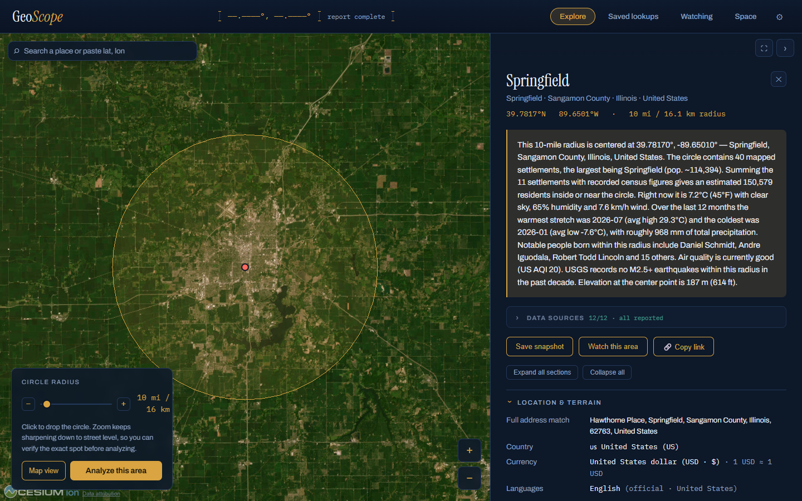

# GeoScope

An interactive 3D globe with street-level tile resolution. Click anywhere on Earth, set a circle radius (1–250 miles), and get a full intelligence report on everything inside it — then save reports to a history tab, or **watch** an area so the server re-checks it on a schedule and logs every change.



## Run it

```bash
docker compose up --build
# open http://localhost:8080
```

Or without compose:

```bash
docker build -t geoscope .
docker run -p 8080:8080 -v geoscope-data:/data geoscope
```

The container needs outbound internet access (it queries public, key-free data APIs). The browser loads CesiumJS, fonts, and map tiles (CARTO dark basemap + Esri satellite imagery) from CDNs; tiles stream at increasing resolution as you zoom, down to street level, with a Map/Satellite toggle for verifying the exact spot.

Without Docker (Node 20+): `npm install && npm start`, then open http://localhost:8080.

### Configuration

| Variable | Default | Meaning |
|---|---|---|
| `PORT` | `8080` | Listen port |
| `DATA_DIR` | `./data` (`/data` in the container) | Where saved places and watches persist (two JSON files, written atomically) |
| `AREA_CACHE_MS` | `300000` | TTL of the hot-path report cache (5 minutes) |
| `GEOSCOPE_CONTACT` | `localhost` | Contact (email or URL) sent in the outbound `User-Agent`. Nominatim and the Overpass operators ask every client to be reachable — set this when you self-host. |

GeoScope has no authentication: every `/api` route is an open relay to the public services above. Run it on your LAN or behind something that does authenticate; exposed to the internet it would become a free proxy and get its IP banned upstream.

## What's in a report

| Section | Source | Notes |
|---|---|---|
| Summary paragraph | composed server-side | one-glance overview of everything below |
| Exact location & address hierarchy | OpenStreetMap Nominatim (reverse geocode) | locality, county, state, country, postcode |
| Coordinates, elevation, time zone | click point + Open-Meteo | lat/lon to 6 decimals |
| Country currency + USD rate | mledoze/countries dataset + open.er-api.com | shown in Location & terrain; rate refreshed every 12 h |
| Every settlement in the circle | OpenStreetMap Overpass | cities, towns, villages, hamlets, suburbs with population tags and distance from center; click a name for an in-app Wikipedia preview (resolved via the place's own OSM `wikipedia`/`wikidata` tags or a coordinate+name match — never the bare name) |
| Estimated population | sum of OSM census tags | labeled as a floor estimate |
| Current weather + 7-day forecast | Open-Meteo | temp, feels-like, humidity, wind, cloud, precip |
| Weather history | Open-Meteo Archive | last 12 months, monthly avg high/low and precipitation, with chart |
| Notable people | Wikidata SPARQL | people whose *recorded birthplace coordinates* fall inside the circle, ranked by global Wikipedia coverage |
| Landmarks / points of interest | Wikipedia GeoSearch (≤10 mi circles) / Wikidata coordinate query (larger) | small circles list every geotagged article; larger ones switch to the most globally notable places across the whole radius, settlements excluded — so coverage isn't centre-biased |
| Surveillance devices | OpenStreetMap (ALPR positions largely crowdsourced via [DeFlock](https://deflock.me)) | license plate readers, surveillance cameras, speed cameras, gunshot detectors — publicly documented positions only, plottable on the globe; volunteer-mapped, so counts are floors |

Report sections are collapsible (collapsed by default) so the report reads as a scannable index — headers carry the key figure, and **Expand all / Collapse all** sit at the top.

## How location accuracy is guaranteed

Every upstream query is keyed by the **exact latitude/longitude** of the click — never by a place name. That means:

- A click near Springfield, Missouri can never return data for Springfield, Illinois: the geocoder, settlement scan, weather, people, and landmark queries all receive the same raw coordinates.
- The report shows the full reverse-geocoded hierarchy (locality → county → state → country) so you can verify which of the world's same-named places you're looking at.
- "Notable people" uses a coordinate-bounded Wikidata query (`wikibase:around`), so it finds people born at places *inside your circle*, not people associated with a same-named town elsewhere.
- The circle drawn on the globe is a true geodesic circle, so the visual matches what's queried.

## Saved lookups

Press **Save snapshot** on any report. A saved place is the *exact* coordinates + radius, owning an append-only timeline of immutable report snapshots — **＋ New snapshot** re-runs the analysis for the identical spot and appends the result, so you build a longitudinal record (the original is always kept, with up to 50 snapshots per place). Each snapshot expands to its full report with an age banner; snapshots and whole places can be deleted (✕). Stored as JSON in the `/data` volume; pre-timeline saves migrate automatically on first boot.

**Snapshot diffing** makes the timeline legible: every snapshot row has a **Δ Diff** button comparing it to the previous one, and the place card offers **Δ Original → latest** across the whole timeline. The diff lists added/removed settlements, landmarks, notable people; population, infrastructure, surveillance, and seismicity deltas; moment-in-time readings (weather, AQI) are shown separately since they always differ. Computed entirely client-side from the stored snapshots — no API calls.

## Watching areas

Press **Watch this area** on any report and the server re-checks that point on a schedule, even with no browser open:

Cadence is proportionate to how fast each source moves:

- **Every 30 minutes:** news headlines — the liveliest source.
- **Hourly:** new earthquakes and severe-weather transitions (thunderstorms, heavy snow — never small temperature swings).
- **Every 3 hours:** air-quality *band* changes (Good → Moderate, never raw AQI jitter).
- **Weekly:** settlements & population tags, Wikipedia landmarks, notable people, infrastructure counts — slow-moving map data where any change is meaningful.

The **Watching** tab shows each watch as a change-log timeline; unseen changes are badged on the tab and highlighted in brass. Per-watch metric pills toggle which sources are monitored, **Check now** forces an immediate re-check, and **Mark seen** clears the badge. Checks run one at a time with a gap between upstream calls, and watches are capped at 20, so the app stays polite to the public APIs. State persists in `/data/watches.json`.

### Notifications

Every watch can push its changes out as they're detected — press **🔔 Notify** on a watch card and paste a URL:

- **ntfy** — free phone push with zero accounts: install the [ntfy](https://ntfy.sh) app, subscribe to a topic, paste `https://ntfy.sh/your-topic`. Each change arrives as a notification with a per-source emoji tag.
- **Discord webhooks** — changes arrive as embeds (auto-detected from the URL).
- **Generic JSON** — any endpoint that accepts a POST (Home Assistant, IFTTT, your own scripts) gets `{event, watch, change}`.

**Send test** fires a synthetic change to confirm delivery; the card shows the last delivery outcome (or the exact failure). Deliveries are fire-and-forget with one retry. Each watch also exposes an **RSS feed** of its change log (`/api/watches/:id/rss` — the RSS button copies the URL), so any feed reader works as a channel with no configuration at all.

## Space tab

A dedicated tab so orbital data never clutters the land-based report. Opening it pulls CelesTrak orbital element sets (space stations + the ~150 brightest satellites, cached server-side for 6 h) and propagates **real positions in the browser** with satellite.js (SGP4) — the dots orbit the globe because the physics says so, with no position polling at all. Stations render in brass with name labels (the ISS also gets its next full revolution drawn as a ring), bright satellites in teal; clicking any dot — or a name in the list — opens the in-app Wikipedia preview, resolved through the object's satellite catalog number on Wikidata (P377), never its display name, and ◎ — or the dot itself — locks the camera onto the object and follows it through its orbit (✕ or Esc releases). A panel card shows who is in space right now (Launch Library 2 by The Space Devs — actively maintained, unlike the long-frozen Open Notify feed) with each name clickable for their Wikipedia article (resolved by an occupation-constrained Wikidata match, so "Butch Wilmore" finds Barry E. Wilmore and never a same-named civilian), plus the ISS's live position, altitude, and speed. Objects with no Wikipedia article (most rocket bodies) don't dead-end: the preview falls back to the object's CelesTrak SATCAT record (type, launch date, owner, orbit) and Wikidata description/image when one exists. Every preview follows the language setting natively — Wikipedia editions via sitelinks, fact labels from Wikidata's own translations, dates/numbers/countries via the browser's Intl — never machine translation. The layer exists only while the tab is open and hides itself below ~1,000 km camera height, so street-level verification stays clean; satellites behind the Earth are properly occluded.

## Local time & display settings

Every report includes a live local-time block for the clicked point: ticking local clock, IANA zone + abbreviation, UTC offset, whether daylight saving is observed/in effect (with the standard offset), plus GMT/UTC and your own local time for comparison.

The ⚙ menu (top right) sets display units, stored in the browser: distance (miles / kilometers / both), temperature (°F / °C / both), 12- vs 24-hour clocks, and a Wikipedia preview language. Previews use that language's own Wikipedia edition (resolved via Wikidata sitelinks / langlinks — a native article, not machine translation) and say so when no edition exists and another language is shown instead. All report figures — radius, areas, distances, wind, temps, sunrise/sunset — follow these settings.

## Architecture

```
geoscope/
├── Dockerfile            node:20-alpine, single container
├── docker-compose.yml    maps port 8080, mounts /data volume
├── server.js             entry point: reads the environment, builds the app, starts the scheduler
├── server/
│   ├── app.js            createApp(): Express wiring with no side effects (tests boot it in-process)
│   ├── http.js           shared validation (lat/lon/radius), HttpError, JSON error handling
│   ├── parts.js          one handler per report section + the seven-source /api/area report
│   ├── history.js        saved-place timelines: pure model functions + the file store + migration
│   ├── store.js          atomic JSON file persistence
│   └── routes/           one router per feature: report, history, watches, wiki, space, infrapoints
├── lib/
│   ├── net.js            shared fetch discipline (UA, timeouts, WDQS retry, Overpass mirrors)
│   ├── geo.js            pure geo/numeric helpers (haversine, clamp, unit labels)
│   ├── format.js         pure classifiers (AQI bands, severe-weather codes, name fallbacks)
│   ├── summary.js        the report summarizer
│   └── cache.js          tiny TTL+LRU cache used on the hot path and by data sources
├── sources/              one module per upstream (geocode, settlements, weather,
│                         infrastructure, surveillance, earthquakes, people, landmarks,
│                         news, wiki, space) — each independently importable & testable
├── watch/
│   ├── engine.js         the scheduler: due checks, baselines, change log, notification retry
│   ├── watchers.js       per-source cadence + pure diff/next change-detection logic
│   └── notify.js         ntfy / Discord / JSON notification dispatch
├── fixtures/             deterministic fakes for every upstream API (used by tests and `npm run dev`)
├── test/                 node:test suite: unit, source, scheduler, saved-place and route tests
├── e2e/                  Playwright browser suite against the real server + fixture upstreams
└── public/
    ├── index.html        layout: globe + instrument panel + tabs
    ├── style.css         midnight-atlas theme
    └── js/               ES modules, no build step:
        ├── main.js       wiring: init order, what a globe click means, Escape, deep links
        ├── globe.js      the Cesium viewer, basemaps, selection circle, radius slider
        ├── analyze.js    the live report: parallel source fan-out, dependency chain, summary
        ├── render.js     report HTML (one function per section) + live-only actions
        ├── saved.js / watches.js / space.js     the three other tabs
        ├── flyovers.js + astro.js               SGP4 pass prediction, pure sun/shadow math
        ├── diff.js       snapshot and place comparison (pure)
        ├── plots.js / highlights.js             category plots and temporary pins on the globe
        ├── search.js / wiki.js / tabs.js / controls.js / settingsUi.js
        └── format.js / settings.js / api.js / report-model.js / permalink.js / state.js / events.js
```

The `/api/area` endpoint fans out to all seven sources in parallel (`Promise.allSettled`), so one slow or failed source never sinks the report — failures are listed at the bottom of the report and a retry re-runs everything.

**Hot-path cache.** Re-clicking the same spot used to re-fan-out every upstream call. A short-TTL, coordinate-rounded cache (≈11 m) now sits in front of `/api/area` and `/api/part`, so a repeat lookup is served from memory — faster, and far politer to the public APIs. Responses carry an `X-GeoScope-Cache: hit|miss` header; the TTL defaults to 5 minutes and is tunable with `AREA_CACHE_MS`.

**Tests.** Every upstream API has a deterministic fake in `fixtures/upstream.js`, so the whole stack runs without the network:

- `npm test` — the `node:test` suite (no dependencies): pure logic (differ, summarizer, parsers, cache, the browser's formatting/diff/astronomy modules), every data source against the fakes, the watch scheduler with an injected clock, the saved-place timeline rules, and route tests that boot the full Express app on an ephemeral port and pin every endpoint's status codes, error messages, cache headers and response shapes.
- `npm run test:e2e` — Playwright drives headless Chromium through the real product path (search → analyze → every section → save → timeline diff → watch → notifications → Space tab → previews → settings → deep links → plots) against the real server with fixture upstreams. First run: `npx playwright install chromium`.
- `npm run dev` — the server with fixture upstreams, for hacking on the UI offline.

GitHub Actions (`.github/workflows/ci.yml`) runs the unit/route suite on Node 20 and 22, the browser suite, and a Docker build that checks the container serves the app.

**Sharing & comparing.** Every report's exact spot+radius is encoded in the URL hash (`#@lat,lon,radius`), so a report is bookmarkable and linkable — a 🔗 Copy link button sits beside Save snapshot, and opening a link auto-drops the circle and runs the report. The Saved tab can tick any two places and **Compare** them side by side, reusing the same client-side diff engine that powers snapshot timelines.

**Search to fly.** A search box over the globe takes a place name (Nominatim forward geocode) or raw `lat, lon` — pick a result and the camera flies there and drops the circle, exactly as a click would, so every report stays coordinate-keyed. The full display name is shown for each candidate so you disambiguate same-named places yourself before analyzing.

**Satellite flyovers.** Every report has a *Satellite flyovers* section answering "when will a satellite pass over THIS point, and where in the sky?" — computed entirely in the browser from the same TLEs + SGP4 propagator that drive the Space tab, so it costs zero extra API calls. Each pass lists rise, peak and set (time in the point's local zone, compass bearing, max elevation, duration) and the exact stretch during which it is **visible to the naked eye** — sunlit while your sky is dark, via a cylindrical Earth-shadow model and a low-precision solar position — since a station can fade into Earth's shadow mid-pass. Stations are flagged *bright*; the rest of the visual group *needs dark sky*. Passes are found on a 30 s grid and then re-sampled at 1 s, so times are exact to a second or two; element sets older than 12 h are refetched before a scan. Checked against independent references: the propagated ISS lands within 1 km of a live tracker and the sun model within a minute of published sunrise/sunset.

## Polite API usage

All sources are free public services (Nominatim, Overpass, Open-Meteo, Wikidata, Wikipedia, USGS, CelesTrak, Launch Library 2, open.er-api.com). The app sends a proper User-Agent (set `GEOSCOPE_CONTACT` so it names you, not `localhost`) and makes one request per source per analysis; slow-moving data (orbital elements, currency dataset, exchange rates) is cached server-side. If you deploy this beyond personal use, read each service's usage policy and consider caching or self-hosting Nominatim/Overpass.

GeoScope is designed for **personal self-hosting** — one instance, one operator, watch slots capped, every upstream call paced. That isn't a missing feature; it's the honest size for a polite citizen of these public APIs.

## Development

Contributions welcome — [CONTRIBUTING.md](CONTRIBUTING.md) has the layout, the offline dev server, the checks CI runs, and the ground rules (coordinates over names, one request per source, no machine translation).

Designed and built in collaboration with Anthropic's **Claude (Fable 5)** as an exercise in AI-assisted development: architecture decisions, data-source vetting (including verifying API behavior live before integrating, and cutting sources whose rate limits proved hostile), and browser-level verification of every feature were driven through iterative sessions with the model. Every capability in this README was tested end-to-end in a real browser against the running container before landing.

## License

[GNU AGPL-3.0](LICENSE). You can run, study, modify, and share it freely; if you host a modified version for others, you must offer them your source. The copyleft choice is deliberate — this project lives on free public data services, and AGPL discourages the one failure mode that would harm them: someone wrapping it into a closed, hosted service that hammers those APIs at scale.
